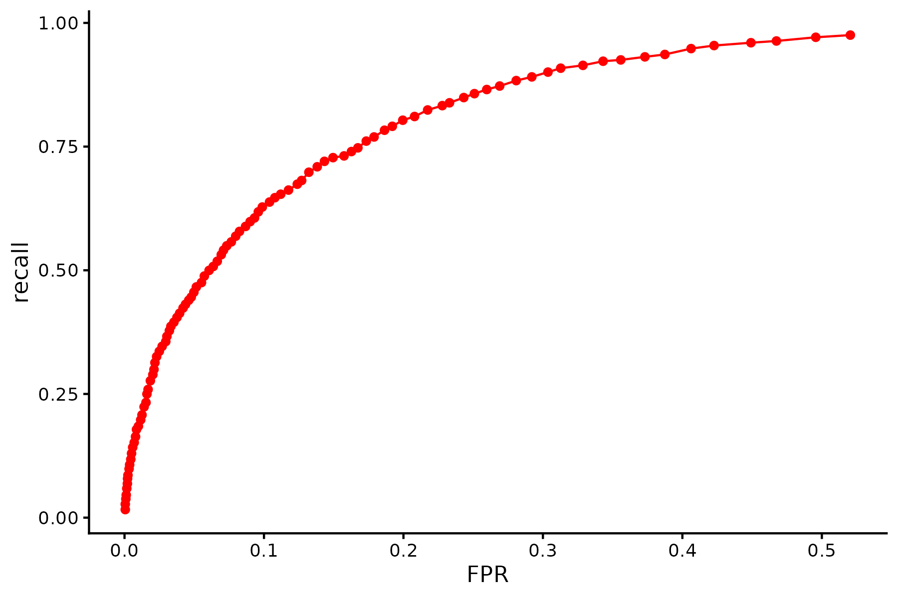
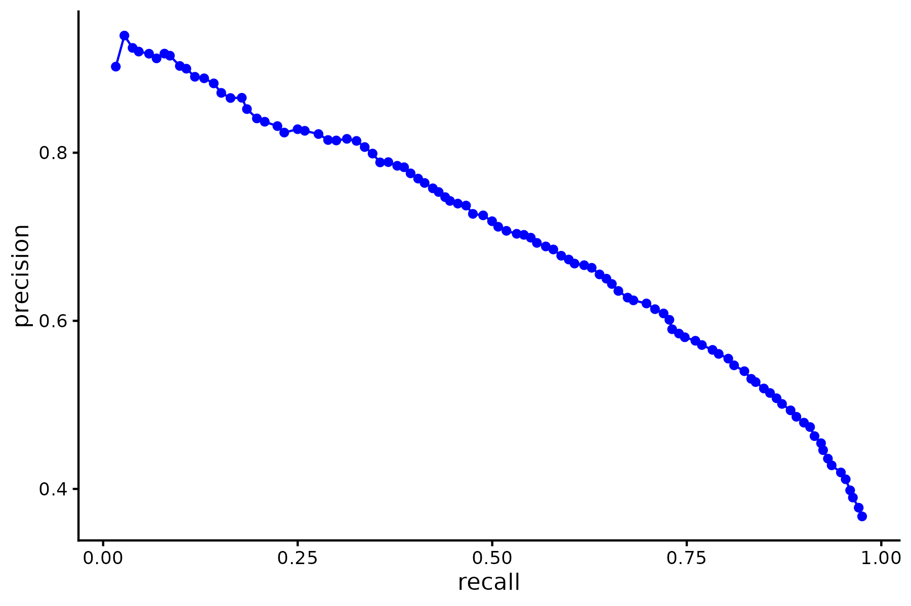

# m6APrediction

m6APrediction is an R package that uses a random forest model to predict m6A sites from sequence and genomic features. The package provides `prediction_single()` for one site and `prediction_multiple()` for multiple sites.

## Installation

Install the package from GitHub using `remotes`. If `remotes` is not installed, run `install.packages("remotes")` first.

```r
remotes::install_github("Jiaxing-Ye/m6APrediction")
```

## Usage

The package includes a trained random forest model and a sample CSV file. Use `prediction_single()` to predict one site and `prediction_multiple()` to predict several sites.

```r
library(m6APrediction)

ml_fit <- readRDS(system.file(
  "extdata", "rf_fit.rds",
  package = "m6APrediction", mustWork = TRUE
))

# Predict a single site
prediction_single(
  ml_fit,
  gc_content = 0.6,
  RNA_type = "mRNA",
  RNA_region = "CDS",
  exon_length = 12,
  distance_to_junction = 5,
  evolutionary_conservation = 0.8,
  DNA_5mer = "GGACA"
)

# Predict the first three sites in the example file
feature_df <- read.csv(system.file(
  "extdata", "m6A_input_example.csv",
  package = "m6APrediction", mustWork = TRUE
))

prediction_multiple(ml_fit, feature_df[1:3, ], positive_threshold = 0.6)
```

## Model Performance

The ROC and precision–recall curves show how the random forest model performs across different classification thresholds.

### ROC Curve



### Precision–Recall Curve


